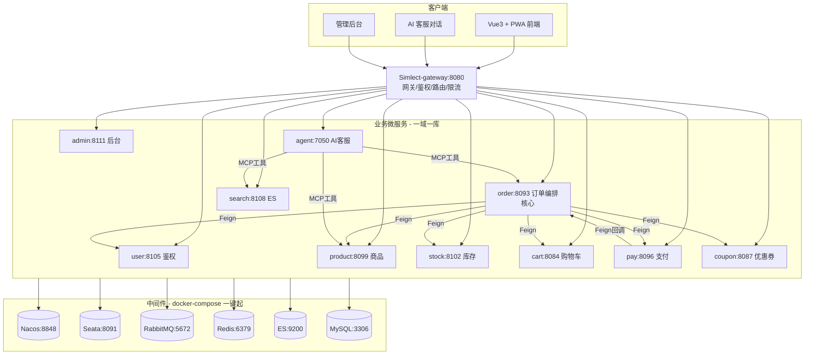
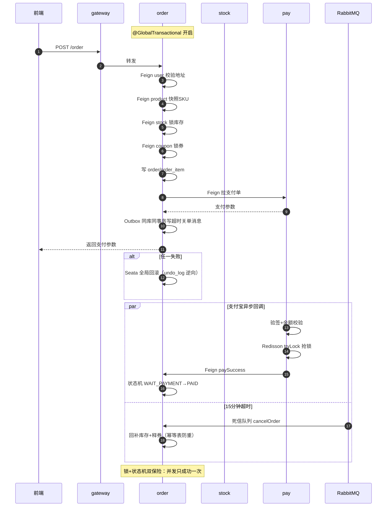

<div align="center">

# 🌌 Aurora-Mall

**极光商城 · Spring Cloud Alibaba 微服务商城 + Vue 3 前端 + Spring AI 智能客服的全栈电商系统**

后端 13 微服务一域一库 · Seata AT 跨库强一致 · Outbox+死信队列最终一致 · 状态机+生命周期锁防并发

Java 17 · Spring Boot 3.5.4 · Spring Cloud 2025 · Spring AI 1.1.2 · Seata · Sentinel · RabbitMQ · Elasticsearch · Vue 3 · Vite · PWA

[](https://openjdk.org/)
[](https://spring.io/projects/spring-boot)
[](https://spring.io/projects/spring-cloud)
[](https://vuejs.org/)
[](https://vitejs.dev/)
[](https://docs.spring.io/spring-ai/)
[](./LICENSE)

[快速开始](#-快速开始) · [架构总览](#-架构总览) · [核心技术亮点](#-核心技术亮点) · [项目结构](#-项目结构) · [各微服务职责](#-各微服务职责) · [导读指南](./ZHIDAO.md)

</div>

---

## 📌 项目简介

Aurora-Mall 是一个全栈电商系统：后端用 Spring Cloud Alibaba 构建 13 个微服务、一域一库，前端 Vue 3 + Vite + Element Plus + PWA，配套 Spring AI + LangChain 双实现的智能客服 Agent，覆盖"浏览→下单→支付→发货→退款→客服"全交易闭环。

**它不是**一个单体 CRUD demo，**而是**一个后端一域一库、跨服务强一致用 Seata、最终一致用 Outbox+MQ、支付回调用状态机+分布式锁防并发的工程级系统。简历意义上的"能打"就在这里——每个高并发难题都有对应的、源码可追溯的解法。

**双主线**：

| 主线 | 技术栈 | 覆盖范围 |
|---|---|---|
| 🏬 **商城交易主线** | Spring Cloud Alibaba | gateway → user → product → stock → cart → coupon → order → pay → search → admin |
| 🤖 **AI 客服主线** | Spring AI + LangChain 双实现 | agent，RAG 检索 + MCP 工具调用 + 意图树 + SSE 流式 |

---

## ✨ 核心技术亮点

> 每条亮点都标注了具体落点文件——没有落点的亮点是空话，删。

### 🔒 分布式事务与一致性

- **Seata AT 全局事务 + 三层容错** — `@GlobalTransactional` 跨 4 库下单原子，任一失败全局回滚；Seata 不可达时 Feign 补偿回补库存/释券，补偿也失败落 `RemoteCompensateRecorder` 等人工兜底（`OrderInfoServiceImpl` catch 块）
- **Outbox + RabbitMQ 死信队列** — 业务表与消息表同库同事务写，后台 dispatch 异步投递 MQ 保"DB 提交即 MQ 必发"；15 分钟超时未付自动关单（`ReliableMessageSender` / `TransactionalMqSender` + `PAY_TIMEOUT_DEAD_QUEUE`）
- **事务后 ack 本地事务消息** — MQ 消费者把 ack/nack 挂到 Spring 事务提交/回滚回调，DB 提交才 ack、回滚则 nack 重试——不用 XA 也能保证 DB 与 MQ 一致（`RabbitMQPayOrderDeadListenerComponent#registerAckSync`）
- **MQ 消费幂等表** — `MqIdempotency_keys` 表先查后消费，MQ 重复投递也只做一次

### 🎛️ 并发与状态安全

- **订单状态机 + Redis 生命周期锁** — 支付/关单并发只成功一次。锁 + 条件更新双保险（`OrderStateMachine` + `OrderStateEvent` + paySuccess 内 `WHERE status=WAIT_PAYMENT`）
- **迟到支付退款不复活订单** — 订单已关但支付回调迟到时，`refundLatePaymentAfterClose` 原路退款不复活订单——防"关了又付"的资金事故（`handlePaySuccessConflict`）
- **退款金额按实付比例分摊** — 用券订单按券后实付退款，防按原价超退（`doRefund` → `calcRefundAmount`）
- **Redisson 看门狗锁防重复回调** — 支付宝异步回调 tryLock 抢锁，抢不到即忽略（`PayNotifyController`）
- **分布式定时任务锁** — SET NX EX + Lua 比对删除防误删他人锁，多实例只一个外呼支付（`PayOrderTask`）
- **AOP 代理调事务方法** — `exposeProxy=true` + `AopContext.currentProxy()`，防同类内调 `this.xxx()` 绕过 AOP 导致 `@Transactional` 失效

### 💰 支付安全

- **支付宝验签 + 实付金额校验** — 防伪造回调篡改金额（`PayChannel4AliPay`）
- **退款四重幂等闸** — Redis `tryMarkOrderRefundOnce` + 事务回滚清标记 + pay 侧 `refundOrderId` + `refundOrderId` 锚点复用，四层防重复退款

### 🎟️ 高并发热点

- **秒杀券 Redis Lua 预占** — 热路径挡在内存层，不进 DB 长事务；预占成功后 Feign 超时重试复用已建订单不卡死（`prepareCouponRush` rushCode==2 分支）

### 🛡️ 服务治理

- **Feign Fallback 降级** — 下游挂了明确失败不 NPE，下单必回滚（各 `*FeignFallbackFactory`）
- **Sentinel 限流熔断** — Feign 调用链路保护
- **OpenFeign 重试** — `max-retries-on-next-service-instance:1`

### 🤖 AI 客服

- **Spring AI + LangChain 双实现** — RAG 检索（ES + Embedding + Rerank）+ MCP 工具调用 + 意图树 + SSE 流式
- **跨语言编排** — Python agent(7050) + Java ragent，MCP Server(7060)

### 🧪 工程质量

- **测试齐全** — `*Test.java` 单元测试 + `*IT.java` Testcontainers 集成测试 + JaCoCo 0.8.12 覆盖率
- **优雅停机** — `server.shutdown: graceful` + 30s 超时
- **生产就绪校验** — `SIMLECT_PRODUCTION_READY=true` 把关
- **模拟物流链式投递** — 事务提交后投递下一条延迟消息，链式推进每站 1 小时，走完触发自动确认收货（`processOrderLogistics` afterCommit）

### 🗺️ 并发难题 → 解法速查表

> 每个并发难题都有对应的、源码可追溯的解法——这是本项目最大的含金量。

| 并发难题 | 解法 | 落点文件 |
|---|---|---|
| 跨 4 库下单不一致 | Seata AT `@GlobalTransactional` 全局事务 | `OrderInfoServiceImpl.postOrder` |
| Seata TC 不可达 | Feign 补偿回补 + RemoteCompensateRecorder 落库兜底 | `postOrder` catch 块 |
| DB 提交了 MQ 没发 | Outbox 同库同事务写消息表 + dispatch 异步投递 | `TransactionalMqSender.sendAfterCommit` |
| MQ 重复消费 | 消费幂等表 `MqIdempotency_keys` 先查后消费 | `MqListenerHelper.tryBeginConsume` |
| DB 与 MQ 一致性 | 事务后 ack：DB 提交才 ack，回滚则 nack 重试 | `registerAckSync` |
| 支付与关单并发 | 生命周期锁 + 状态机条件 UPDATE 双保险 | `runWithPayOrderLifecycleLock` + `transition` |
| 支付迟到（已关单） | 原路退款不复活订单 | `refundLatePaymentAfterClose` |
| 重复退款 | 四重幂等闸：Redis + 事务回滚清标记 + pay 侧 + 锚点 | `refundInLock` + `doRefund` |
| 用券订单按原价超退 | 退款金额按券后实付比例分摊 | `calcRefundAmount` |
| 重复支付宝回调 | Redisson 看门狗锁 tryLock | `PayNotifyController` |
| 多实例重复外呼支付宝 | SET NX EX + Lua 比对删除分布式锁 | `PayOrderTask` |
| 秒杀瞬时流量打垮 DB | Redis Lua 原子预占挡在内存层 | `prepareCouponRush` |
| 秒杀 Feign 重试卡死 | rushCode==2 复用已建订单 | `prepareCouponRush` |
| 同类内调 @Transactional 失效 | exposeProxy + AopContext.currentProxy() | `RabbitMQPayOrderDeadListenerComponent` |
| 暴力撞库 | IP 维度失败锁定 | `UserLoginLockService` |
| 邮箱验证码轰炸 | IP 限流 + 邮箱维度 Redis 计数 + 滑动验证码 | `AccountController.getEmailCode` |
| 老密码格式不安全 | 登录成功后无感升级 bcrypt | `AccountController.login` |

<details>
<summary><b>📖 亮点落点文件速查表（点击展开）</b></summary>

| 亮点 | 落点文件 |
|---|---|
| Seata 全局事务 | `Simlect-order/.../OrderInfoServiceImpl.java`（`@GlobalTransactional postOrder`） |
| Outbox+死信队列 | `ReliableMessageSender` / `TransactionalMqSender` + `RabbitMQPayOrderDeadListenerComponent` |
| 状态机 | `OrderStateMachine` + `OrderStateEvent` + `OrderStatusEnum`（10 状态） |
| 生命周期锁 | `OrderInfoServiceImpl.paySuccess`（Redis lock + 条件更新） |
| Redisson 回调锁 | `PayNotifyController`（tryLock 看门狗续期） |
| 退款幂等闸 | `PayChannel4AliPay`（out_request_no） |
| 定时任务锁 | `PayOrderTask`（SET NX EX + Lua 释放） |
| 秒杀 Lua 预占 | `prepareCouponRush`（coupon 模块） |
| Feign 降级 | 各 `*FeignFallbackFactory`（如 `PayFeignFallbackFactory`） |
| AI 客服 | `Simlect-agent/`（Python LangChain + Java Spring AI 双实现） |

</details>

---

## 🏗️ 架构总览

### 系统架构图



### 下单链路时序图



---

## 🧰 技术栈

| 类别 | 技术 | 版本 |
|---|---|---|
| 后端语言 | Java | 17 |
| 后端框架 | Spring Boot | 3.5.4 |
| 微服务栈 | Spring Cloud + Spring Cloud Alibaba | 2025 / 2025.0.0.0 |
| AI 框架 | Spring AI | 1.1.2 |
| 服务治理 | Nacos · Sentinel · Seata(AT) · OpenFeign | — |
| 持久化 | MySQL · MyBatis | 8.3.0 / 3.0.5 |
| 缓存/锁 | Redis + Redisson | 7-alpine / 4.0.0 |
| 消息 | RabbitMQ（publisher confirm + 手动 ack + 死信队列） | 3.13 |
| 搜索 | Elasticsearch + analysis-ik | 9.2.1 |
| 支付 | Alipay SDK Java | 4.40.576 |
| 前端框架 | Vue · Vite · Pinia · Vue Router · Element Plus | 3.5 / 8 / 3 / 4.6 / 2.14 |
| 前端工具 | TypeScript · Sass · vite-plugin-pwa · markdown-it · cropperjs | 6.0 / 1.100 / 1.3 / 14 / 2.x |
| 部署 | Docker Compose · Nginx | — |
| 测试 | JUnit 5 · Testcontainers · JaCoCo | 1.21 / 0.8.12 |

---

## 📂 项目结构

```
Aurora-Mall/                            # 全栈项目根
├── README.md                       # 📃 项目门面（本文件）
├── Description.md                  # 📋 项目名片（GitHub About）
├── ZHIDAO.md                       # 📖 项目导读指南
├── LICENSE                         # Apache 协议
├── sql/                           # 🗄️ 建库脚本（一域一库，16 个库）
├── deploy/                        # 🚀 部署
├── docs/                          # 📚 文档截图
├── Simlect-front/                 # 🖥️ 前端（不加注释）
│   ├── Simlect-web/                    # 用户端 Vue3+Vite+PWA
│   └── Simlect-admin/                # 管理后台
└── Simlect-backend/ ⭐ 加注释       # 后端（654 Java 文件）
    ├── pom.xml
    ├── Simlect-common/  Simlect-gateway/
    ├── Simlect-user/  Simlect-product/  Simlect-stock/  Simlect-cart/
    ├── Simlect-order/  Simlect-pay/  Simlect-coupon/
    └── Simlect-search/  Simlect-admin/  Simlect-agent/
```

<details>
<summary><b>📁 完整目录树（点击展开）</b></summary>

```
Aurora-Mall/
├── README.md · Description.md · ZHIDAO.md · LICENSE
├── sql/
│   ├── 00_create_databases.sql       # 建库
│   ├── 00b_nacos_seata_databases.sql # nacos/seata 元数据库
│   ├── 01_user.sql … 10_admin.sql    # 各业务表
│   ├── 13_mq_infra_per_service.sql    # Outbox+补偿日志
│   ├── 14_nacos.sql / 15_seata.sql    # 中间件元数据
│   └── 16_seata_undo_log.sql          # Seata 回滚表
├── deploy/
│   ├── docker-compose.middleware.yml  # 一键起 7 中间件
│   ├── start-middleware.ps1 · init-mysql-meta.ps1
│   ├── env.production.example · nginx.simlect.conf.example
│   ├── GO_LIVE.md · MIDDLEWARE_DOCKER.md · FULL_STACK.md
│   └── seata/ · elasticsearch/         # 自建镜像
├── docs/
├── Simlect-front/
│   ├── Simlect-web/   package.json: vue 3.5, vite 8, element-plus 2.14, pinia 3, vue-router 4.6, crypto-js, markdown-it, qrcode, cropperjs, vite-plugin-pwa
│   └── Simlect-admin/
└── Simlect-backend/
    ├── pom.xml                       # 父 POM：Java17+Boot3.5.4+Cloud2025+AI1.1.2
    ├── Simlect-common/              # 公共底座：ResponseVO/异常/枚举/StringTools/Redis组件/Feign基类
    ├── Simlect-gateway/             # 网关：路由/鉴权/限流（端口 8080）
    ├── Simlect-user/                 # 用户中心：注册/登录/JWT/验证码/收货地址（8105）
    ├── Simlect-product/              # 商品：SPU/SKU/分类/规格（8099）
    ├── Simlect-stock/                # 库存：扣减/回补（8102）
    ├── Simlect-cart/                 # 购物车（8084）
    ├── Simlect-order/ ⭐             # 订单编排中心（8093）：Seata+Outbox+状态机+生命周期锁
    ├── Simlect-pay/                  # 支付宝渠道/回调验签/退款幂等（8096）
    ├── Simlect-coupon/              # 优惠券：秒杀券 Redis Lua 预占（8087）
    ├── Simlect-search/             # ES 商品检索（8108）
    ├── Simlect-admin/               # 后台管理/审计/敏感词（8111）
    └── Simlect-agent/ 🤖           # AI 客服：Python(LangChain)+Java(Spring AI) 双实现
```

</details>

---

## 🏬 各微服务职责

| 微服务 | 端口 | 库 | 职责 | 核心机制 |
|---|---|---|---|---|
| **gateway** | 8080 | — | 路由/鉴权/限流入口 | Spring Cloud Gateway + 鉴权过滤器 |
| **user** | 8105 | simlect_user | 注册/登录/Token/地址 | JWT + 验证码 + Redis Token |
| **product** | 8099 | simlect_product | SPU/SKU/分类/规格 | 商品快照（下单时锁定） |
| **stock** | 8102 | simlect_stock | 扣减/回补 | Seata 分支 |
| **cart** | 8084 | simlect_cart | 增删改查 | — |
| **order** ⭐ | 8093 | simlect_order | **编排中心** | Seata + Outbox + 状态机 + 生命周期锁 |
| **pay** | 8096 | simlect_pay | 支付宝/验签/退款 | Redisson 锁 + 退款幂等闸 |
| **coupon** | 8087 | simlect_coupon | 优惠券/秒杀 | Redis Lua 预占 |
| **search** | 8108 | — | ES 检索 | analysis-ik 中文分词 |
| **admin** | 8111 | simlect_admin | 后台/审计/统计 | — |
| **agent** 🤖 | 7050 | — | AI 客服 | Spring AI + LangChain + MCP |

**常用数据流向**：

- 下单：前端 → gateway → order（Feign 调 stock/product/user/coupon/pay）→ Outbox 发 MQ
- 支付回调：支付宝 → pay（验签+锁）→ Feign → order.paySuccess
- 超时关单：MQ 死信 → order.cancelOrder（回补库存+释券，幂等表防重）
- AI 客服：前端 → agent(SSE) → RAG(ES+Embedding) + MCP 工具 → LLM 流式

### 订单状态机

| 状态码 | 枚举 | 说明 | 可流转到 |
|---|---|---|---|
| -1 | DELETE | 已删除 | （终态） |
| 0 | WAIT_PAYMENT | 待付款 | PAID / CANCELLED |
| 1 | PAID | 已付款待发货 | SHIPPED |
| 2 | SHIPPED | 已发货 | COMPLETED |
| 3 | COMPLETED | 已完成 | REFUNDED |
| 4 | CANCELLED | 交易取消 | （终态） |
| 5 | CLOSED | 交易关闭 | （终态） |
| 6 | REFUNDED | 已退款 | （终态） |
| 7 | PARTIALLY_REFUNDED | 部分退款 | REFUNDED |
| 8 | WAIT_COMMENT | 待评价 | COMPLETED |

---

## 🚀 快速开始

### 0️⃣ 环境要求

| 组件 | 版本 | 默认端口 |
|---|---|---|
| JDK | 17 | — |
| Maven | 3.6+ | — |
| Node.js | 18+ | — |
| Docker | 20+ | — |

中间件全部用 docker-compose 一键起，**不用本地安装**。

### 1️⃣ 启动中间件

```bash
cd deploy
docker compose -f docker-compose.middleware.yml up -d
docker compose -f docker-compose.middleware.yml ps   # 全部 healthy 后继续
```

| 中间件 | 端口 | 账号 | 控制台 |
|---|---|---|---|
| MySQL | 3306 | root/root | — |
| Redis | 6379 | — | — |
| RabbitMQ | 5672 | simlect/simlect | http://localhost:15672 |
| Nacos | 8848 | — | http://localhost:8848/nacos |
| Elasticsearch | 9200 | — | — |
| Sentinel | 8858 | sentinel/sentinel | http://localhost:8858 |
| Seata TC | 8091 / 7091 | seata/seata | http://localhost:7091 |

### 2️⃣ 初始化数据库

```bash
# 中间件元数据库
powershell -ExecutionPolicy Bypass -File ./deploy/init-mysql-meta.ps1

# 业务库按序
mysql -uroot -proot < sql/01_user.sql
# ... 按序执行 01-10、13、16
mysql -uroot -proot < sql/16_seata_undo_log.sql
```

### 3️⃣ 编译后端

```bash
cd Simlect-backend
export JAVA_HOME=/path/to/jdk17
mvn clean install -DskipTests
```

### 4️⃣ 启动服务（按依赖顺序）

```bash
cd Simlect-gateway && mvn spring-boot:run          # 网关先起
cd Simlect-order/app && mvn spring-boot:run        # 业务服务
cd Simlect-agent && python -m app.mcp_server         # MCP Server:7060
cd Simlect-agent && python -m app.main                 # agent:7050
```

<details>
<summary><b>⚙️ 生产环境变量（点击展开）</b></summary>

复制 `deploy/env.production.example`，至少改：

| 变量 | 必填 | 说明 |
|---|---|---|
| `SIMLECT_PRODUCTION_READY` | 是 | 生产就绪总开关 |
| `SIMLECT_INTERNAL_TOKEN` | 是 | 服务间鉴权 token |
| `MYSQL_PASSWORD` | 是 | MySQL 密码 |
| `RABBIT_PASSWORD` | 是 | RabbitMQ 密码 |
| `ADMIN_PASSWORD` | 是 | 管理员初始密码 |
| `PROJECT_FOLDER` / `PROJECT_DOMAIN` | 是 | 部署路径/域名 |
| `ALIPAY_*` | 视情况 | 支付宝证书与密钥（开放支付时） |

</details>

### 5️⃣ 启动前端

```bash
cd Simlect-front/Simlect-web
npm install
npm run dev      # 开发
npm run build    # 生产（自动生成 PWA 资源）
```

### 6️⃣ 冒烟测试

- [ ] Nacos 服务全部 UP
- [ ] C 端注册/登录
- [ ] 商品列表与详情
- [ ] 加购 → 下单 → 支付回调（或沙箱）
- [ ] 订单超时关单 / Outbox 有 SENT 记录
- [ ] 管理端登录与订单列表
- [ ] Agent 对话经 Gateway 正常

---

## ⚙️ 配置说明

<details>
<summary><b>📋 核心配置项（点击展开）</b></summary>

| 配置项 | 默认值 | 说明 |
|---|---|---|
| `server.shutdown` | graceful | 优雅停机 |
| `spring.cloud.nacos.discovery.server-addr` | 127.0.0.1:8848 | Nacos |
| `seata.data-source-proxy-mode` | AT | 自动 undo_log |
| `spring.cloud.openfeign.sentinel.enabled` | true | Feign 接 Sentinel |
| `spring.rabbitmq.listener.simple.acknowledge-mode` | manual | 手动 ack |
| `simlect.internal.token` | 环境变量 | 服务间鉴权 |
| `simlect.feign.read-timeout-ms` | 10000 | Feign 读超时 |
| `mq.outbox.dispatch-enabled` | true | Outbox 投递 |
| `mq.compensation.auto-replay-enabled` | true | 补偿重放 |

</details>

---

## 📖 配套文档

| 文档 | 说明 |
|---|---|
| [ZHIDAO.md](./ZHIDAO.md) | 项目导读指南（10 章） |
| [Description.md](./Description.md) | 项目名片（中英双版） |
| [deploy/GO_LIVE.md](./deploy/GO_LIVE.md) | 上线清单 |
| [deploy/MIDDLEWARE_DOCKER.md](./deploy/MIDDLEWARE_DOCKER.md) | 中间件 Docker 部署 |

---

## 🧪 测试

```bash
cd Simlect-backend
mvn test          # 单元测试 *Test.java
mvn verify -Pit   # 集成测试 *IT.java（Testcontainers）
```

---

## 🗺️ Roadmap

- [x] 13 微服务后端骨架 + 一域一库
- [x] Seata AT 全局事务
- [x] Outbox + RabbitMQ 死信队列超时关单
- [x] 支付宝沙箱回调链路
- [x] AI 客服 Spring AI + LangChain 双实现
- [x] docker-compose 中间件一键起
- [x] Sentinel 限流熔断
- [ ] 前端管理后台补全
- [ ] 监控告警接入

---

<div align="center">

## 🤝 参与贡献

Fork → 新建分支 → PR

## 📄 License

Apache License

⭐ 如果对你有帮助，欢迎 Star

</div>